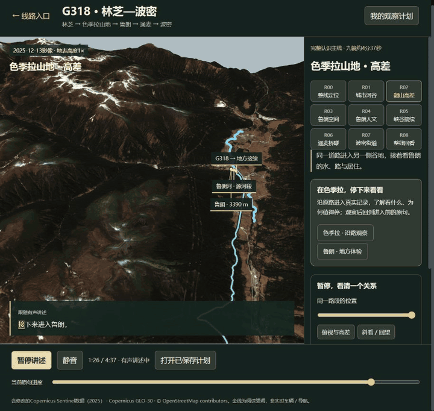
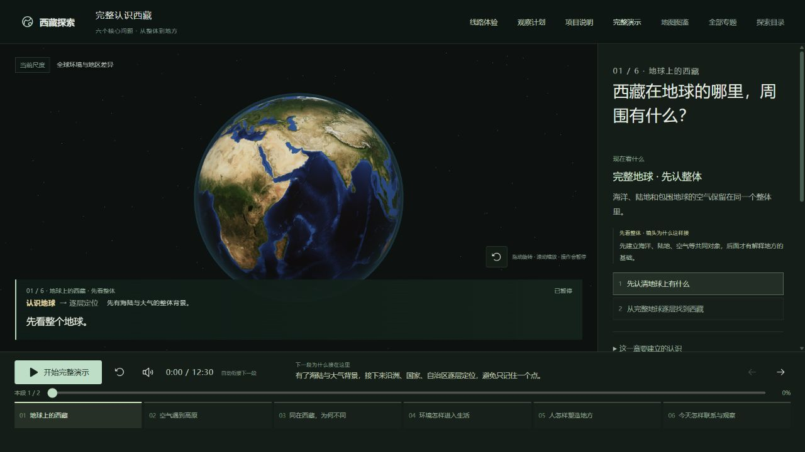
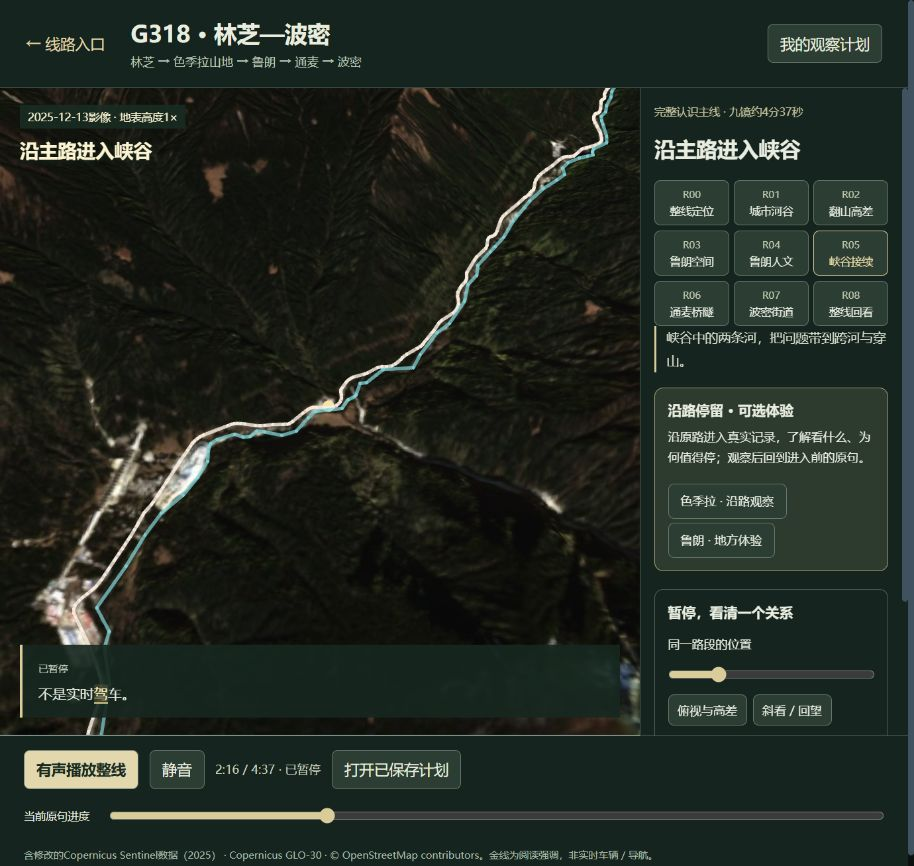

# 西藏探索 · 从地球到真实地方

以真实资料为基础，通过交互式 3D 地图、地形与过程演示、实拍影像和同步语音，理解西藏的地理、气候、生活、人文历史及现代联系。先建立整体认识，再沿 G318 进入具体地方，把观察问题和资料带走。

**[▶ 打开在线演示](https://yydshly.github.io/tibet-explorer/)** · **[沿 G318 林芝—波密前进](https://yydshly.github.io/tibet-explorer/#/routes/g318-east/whole)** · [线路选择](https://yydshly.github.io/tibet-explorer/#/routes) · [项目说明与验收记录](https://yydshly.github.io/tibet-explorer/project-review/index.html)

## 产品演示

### 19 秒动态预览 · 沿线进入鲁朗

[](https://yydshly.github.io/tibet-explorer/#/routes/g318-east/whole)

**19 秒连续实录，原速，约 5.8 MB。** 从色季拉山地沿道路拉近到鲁朗谷地，随后进入林海、河流道路与聚落的实拍，字幕和对象标注跟随既有配音时间轴变化。GIF 本身无声；点击动图进入[有声完整体验](https://yydshly.github.io/tibet-explorer/#/routes/g318-east/whole)。录制复用当前版本，未新增场景或镜头。[录制与素材出处](docs/screenshots/README.md)

以下为 **2026-10-20 在线版本实际运行截图**。点击图片进入对应体验；动态镜头、条件对照和同步讲述请在网页中观看。

### 从完整地球理解西藏

六章围绕“在哪里 → 空气遇到高原 → 地区差异 → 环境与生活 → 人怎样塑造地方 → 今天的联系与观察”展开，主线约 **12 分 30 秒**。可暂停、旋转缩放、改变部分演示条件，再继续原讲述。

[](https://yydshly.github.io/tibet-explorer/#/overview)

### 沿真实道路，把风景与地方联系起来

**林芝 → 色季拉山地 → 鲁朗 → 通麦 → 波密**，九镜主线约 **4 分 37 秒**。卫星影像、地表高程、道路与水系共同解释翻山入谷和跨河穿山；进入地方后，结合有日期与出处的实拍观察村镇生活。支持沿线位置、俯视与斜看等操作，并保留返回原线原句的来路。

[](https://yydshly.github.io/tibet-explorer/#/routes/g318-east/whole)

### 把观察带走，也能回到刚才的讲述

从当前对象进入观察计划，带入画面、问题和资料出处，编辑笔记、保存、导出 Markdown，再返回原画面和原句。计划保存在当前浏览器，可刷新后继续。

[](https://yydshly.github.io/tibet-explorer/#/routes/g318-east/whole)

截图中的历史生活照片：reurinkjan，2008-09-18，[原图出处](https://commons.wikimedia.org/wiki/File:Pocket_billiards,_%E0%BD%A6%E0%BE%92%E0%BE%B2%E0%BD%BC%E0%BD%98%E0%BC%8B%E0%BD%A6%E0%BE%9F%E0%BD%BA%E0%BD%82%E0%BD%A6%E0%BC%8B%E0%BD%A6%E0%BE%A4%E0%BD%BC%E0%BC%8B%E0%BD%A3%E0%BD%BC%E0%BC%8D.jpg)，[CC BY 2.0](https://creativecommons.org/licenses/by/2.0/)。地形与影像截图含修改的 Copernicus Sentinel 数据（2025）、Copernicus GLO-30 及 © OpenStreetMap contributors。截图保留界面中的资料身份与年代，不代表当前实时街景。

## 建议怎样体验

1. 打开在线演示，点击“开始完整演示”，从地球与环境建立整体认识。首次有声播放需要点击播放按钮。
2. 从“线路体验”进入 G318 整线，观察翻山入谷、河流道路与村镇的关系；也可直接使用上方线路链接。
3. 暂停并改变位置或视角，进入色季拉、鲁朗的既有观察内容；点击“继续原句”回到讲述。
4. 将感兴趣的对象带入观察计划，编辑、保存或导出，再用“保存并返回原画面原句”继续。

## 当前交付范围

| 部分 | 当前可以体验 |
| --- | --- |
| 六章整体认识 | 21 段连续讲述，地球定位、气候地形、地区比较、生活、人文历史和现代联系 |
| G318 示范线路 | 林芝—色季拉—鲁朗—通麦—波密整线及既有独立路段 |
| 地方观察 | 色季拉沿路观察、鲁朗地方体验，以及已有通麦和波密材料 |
| 语音与标注 | 预生成普通话讲述，已有 354 段录音及其原生逐词字幕；适用画面随录音时间推进 |
| 观察计划 | 带入对象、问题与来源，编辑、保存、导出和返回原讲述 |
| 资料阅读 | 来源、年代、适用范围与原理示意的边界说明 |

**状态：阶段冻结候选版，可在线试用；正式验收尚未完成。** 已有主线播放、定点交互和部署检查记录，独立真人听验与首次观看者理解验收仍待补齐。现阶段保持六章、既有路段和镜头冻结，只重开有证据的核心问题。

- 真实道路、高程和影像用于认识空间关系；压缩地图行进不等于写实驾驶，也不提供实时导航、开放状态或按日可订行程。
- 部分生活与文化画面是有日期的静态记录，连续实景视频仍有缺口。过程动画会标明示意范围，不作为实测天气或历史现场复原。
- 观察计划没有账号和跨设备同步；线上网站与 localhost 的记录相互独立，重要笔记请导出保存。
- 影像、地图与研究资料各有许可及出处，仓库公开不代表第三方素材可以不署名或不受限制地再分发。

[阶段交付说明](public/project-review/phase-delivery-20261020.md) · [最终证据与限制](https://yydshly.github.io/tibet-explorer/project-review/index.html#final-delivery-evidence) · [素材说明](ASSETS.md) · [历史迭代记录](README-history.md)

## 本地运行与发布

技术栈：React、TypeScript、Three.js、Vite；现有普通话语音由 MiniMax 预生成。建议使用 Node.js 22。

```bash
npm ci
npm run dev
```

访问终端输出的本地网址。既有内容可直接使用仓库内的预生成音频，无需提供 MiniMax 密钥。

```bash
npm run typecheck
npm run build:pages
npx vite preview --outDir dist/pages --base /tibet-explorer/
```

预览地址使用终端输出的地址，并加上 `/tibet-explorer/` 路径。GitHub Pages 专用构建输出到 `dist/pages`，校验全部 354 对录音/字幕的 SHA-256，保持原始媒体字节不变。旧 `npm run build` 为 Sites 构建，依赖未提交的本地 `.openai/hosting.json`；公开站使用 `build:pages`。

默认主干为 **`master`**。推送主干后，[GitHub Actions](https://github.com/yydshly/tibet-explorer/actions/workflows/pages.yml) 自动构建并发布到 [GitHub Pages](https://yydshly.github.io/tibet-explorer/)。前端不包含 MiniMax 密钥或在线生成服务。
